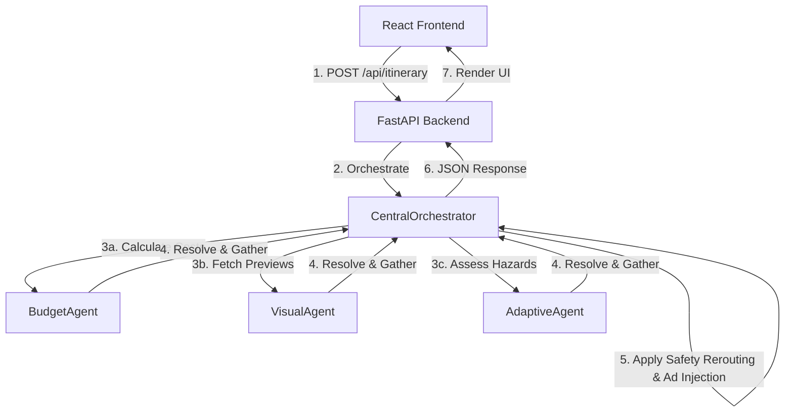

# TripEX ✈️⭐

> **Optimize your travel, unlock student savings, and travel safely with multi-agent AI.**

TripEX is an intelligent, multi-agent travel planning assistant designed specifically for students and budget-conscious travelers (with deep integrations for ISIC and Erasmus entitlements). It automates multi-variable budget optimization, monitors live hazards for silent safety rerouting, and visualizes travel itineraries through synced media timelines.

---

## 📸 Demo & Visuals

Here is an overview of the TripEX experience:

```
+------------------------------------------------------------+
|  TripEX Dashboard                                          |
|  +------------------+  +------------------+  +-----------+  |
|  | Budget Optimizer |  | Visual Journey   |  | Safety    |  |
|  | [Destination]    |  | [ Video Player ] |  | Alerts    |  |
|  | [Budget (€)]     |  |                  |  | (Active)  |  |
|  +------------------+  +------------------+  +-----------+  |
+------------------------------------------------------------+


```

---

## 🎯 What Problem It Solves

Planning budget-friendly student travel is tedious:
1. **Perk Fragmentation:** Navigating hundreds of scattered student discounts (ISIC, ESN, local transport concessions) is exhausting.
2. **Dynamic Risk Management:** Unexpected weather, transport strikes, or safety disruptions force manual, last-minute rerouting.
3. **Immersive Travel Context:** Traditional list-based itineraries fail to convey the visual vibe of destinations before arrival.

**TripEX** bridges these gaps by running specialized AI agents concurrently to compile a budget-optimized, hazard-aware, visually mapped itinerary in seconds.

---

## 🚀 Key Features

* **Multi-Variable Budget Optimization ([`BudgetAgent`](file:///c:/Users/goofy/TripEX/backend/agents.py#L16)):** Automatically allocates lodging, local transit, meals, and sightseeing within your specified cap. If the ISIC flag is set, it injects student pricing and targets a **30-40% saving bracket** by compounding student perks.
* **Silent Safety Backbone ([`AdaptiveAgent`](file:///c:/Users/goofy/TripEX/backend/agents.py#L321)):** Monitors real-time events (weather, strikes). If a hazard is detected, it automatically swaps affected outdoor activities with safe alternatives, recalculates daily expenses, and maintains the target student discount bracket.
* **Sequential Visual Journey ([`VisualAgent`](file:///c:/Users/goofy/TripEX/backend/agents.py#L266)):** Synchronizes the itinerary with cinematic previews, overlaying timeline events (cost details, savings checkpoints) at precise timestamps.
* **Journey Journal:** Upload thoughts and photos to instantly create shareable recap cards complete with calculated ESN/ISIC savings indicators.
* **Tiered Monetization:** Implements a realistic Free vs. Premium model. The Free tier displays CPM ads tailored to student travelers (e.g., Ryanair, Hostelworld discounts), while the Premium tier provides a clean, ad-free UI.

---

## 🛠️ Tech Stack

* **Frontend:** React 18, TypeScript, Vite, TailwindCSS
* **Backend:** FastAPI, Uvicorn, SQLite3 (database storage)
* **Agent Architecture:** Python-based asynchronous Multi-Agent Orchestrator

---

## 🧬 Architecture & Workflow

TripEX utilizes a central orchestrator that fans out requests to specialized sub-agents asynchronously to reduce planning latency:



---

## 📦 Installation & Setup

### Prerequisites
* **Node.js** (v18 or higher)
* **Python** (v3.10 or higher)

### 1. Clone and Setup Database
Ensure the database is initialized. Run the seeding script in the `backend` folder:
```bash
cd backend
pip install -r requirements.txt
python db_seed.py
```

### 2. Run the Backend API
Start the FastAPI server:
```bash
python main.py
```
The backend API will run on `http://127.0.0.1:8000`. You can access the interactive Swagger docs at `http://127.0.0.1:8000/docs`.

### 3. Run the Frontend App
Open a new terminal window:
```bash
cd frontend
npm install
npm run dev
```
The frontend application will start on `http://localhost:5173`.

---

## ⚙️ Environment Variables

Create a `.env` file in the `backend/` directory if you wish to configure host ports:

```env
PORT=8000
HOST=127.0.0.1
```

---

## 🔌 API Documentation

### 1. Generate Itinerary
* **Endpoint:** `POST /api/itinerary`
* **Request Body:**
```json
{
  "destination": "Kaunas, Lithuania",
  "budget": 150.0,
  "duration": 3,
  "has_isic": true,
  "is_premium": false,
  "simulate_hazard": "weather"
}
```

### 2. Fetch Active Alerts
* **Endpoint:** `GET /api/alerts`
* **Response:** Returns active global alerts for the main landing page.

### 3. Upload Travel Journal
* **Endpoint:** `POST /api/journal/upload`
* **Request Body:**
```json
{
  "title": "My Kaunas Adventure",
  "content": "Had the best time visiting the Kaunas Castle...",
  "mood": "happy",
  "has_isic": true
}
```

---

## 🔮 Future Improvements

* 🛩️ **Real-time API integrations:** Connect live flight aggregates (Ryanair, Wizz Air) and direct hostel booking channels.
* 🧠 **LLM-Powered Dynamic Agents:** Transition from static attraction pools to active LLM agents utilizing Retrieval-Augmented Generation (RAG) for global coverage.
* 👥 **Group Planning Mode:** Allow multiple Erasmus students to sync budgets, split bills, and vote on activities in real-time.
